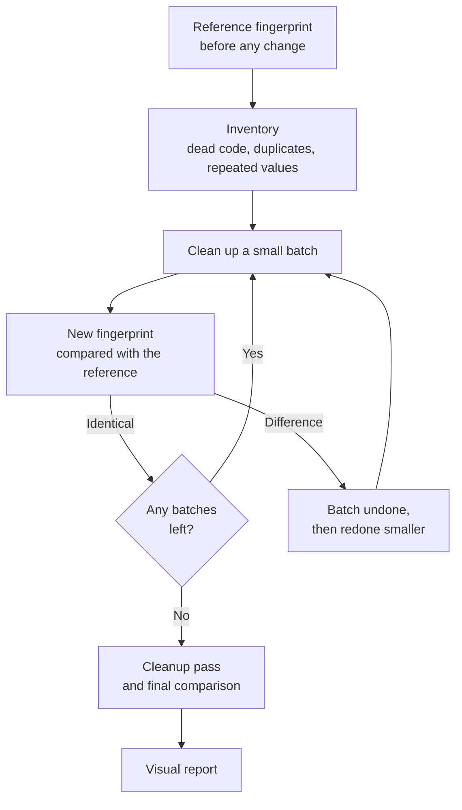

# /proven-refactor: refactor with Claude Code, with proof

**English** · [Français](README.fr.md)

`/proven-refactor` is a skill for Claude Code. It cleans up the code of a web page, a small application or a script without changing anything the user sees, and it proves it with a measurement. The same skill exists in French under the name `/refacto`.

Refactoring means rewriting code so that it is easier to read and maintain, without changing its behaviour. The hard part is the end of that sentence. Re-reading the code or looking at the page is not enough to guarantee that nothing moved: an element shifted by a few pixels, a menu that no longer opens on a phone or a colour that disappears in dark mode easily go unnoticed. This skill replaces that visual check with a measured comparison, before and after every change.


*The screenshot above shows a report generated in French; with `--lang en`, the report is in English.*

## Contents

- [The principle](#the-principle)
- [What the measurement compares](#what-the-measurement-compares)
- [Page states](#page-states)
- [The visual report](#the-visual-report)
- [Weight and speed](#weight-and-speed)
- [Cleanup, fix, decision](#cleanup-fix-decision)
- [The full procedure](#the-full-procedure)
- [Two short modes: light and instructions](#two-short-modes-light-and-instructions)
- [The tools](#the-tools)
- [Installation](#installation)
- [Usage](#usage)
- [Limitations](#limitations)
- [Repository layout](#repository-layout)
- [Author](#author)

## The principle

Before any change, the skill records a **reference fingerprint** of the page. It then cleans up the code in small batches. After each batch, it records a new fingerprint and compares it with the reference. If a difference appears, the batch is undone and redone smaller.



A refactoring is only finished when the final fingerprint is identical to the reference.

## What the measurement compares

The fingerprint is recorded in a real browser (Chromium, driven by Puppeteer), page by page.

| What is compared | What is recorded | What it catches |
|---|---|---|
| Page structure | The rendered DOM, scripts excluded | An element added, removed or moved, even an invisible one |
| Styles | The computed style of every visible element (69 properties) and of its `::before` and `::after` pseudo-elements, plus its position and size | A changed margin, colour or font |
| Accessibility | The tree screen readers read: role, name and state (expanded, checked, disabled) of every element | A button renamed for screen readers, a heading that loses its level, a menu that no longer says whether it is open |
| Focus | The element that has keyboard focus | Broken keyboard navigation |
| Overflow | The actual width of the page | Horizontal scrolling that appeared on phones |
| Rendering | A screenshot of the page, compared pixel by pixel | Any visible difference, with the number of pixels affected and the area |

Each recording is repeated in every combination below:

| Screen width | Light theme | Dark theme |
|---|---|---|
| 375 px (phone) | Measured | Measured |
| 1440 px (desktop) | Measured | Measured |

That makes four recordings for each state of each page. Widths are set with the `--widths` option. The dark theme is only measured if the page supports it; the skill detects this on its own.

So that two successive measurements can be compared, animations, transitions and the text cursor are frozen, and the recording waits for fonts to finish loading. The mouse is moved back to a corner before each recording: a button left under the pointer after a click would skew the next screenshot. The skill also measures the page twice before any change: if those two measurements differ, the page is not stable, and the source of instability is dealt with before starting. Very small colour variations, typical of a resized photo, are reported as "rendering noise" without counting as a difference.

### Example: a changed padding

On a demo page, the inner padding of the cards goes from 18 to 26 pixels. Here is an excerpt of what the tool prints:

```
DIFFERENCE load @ 375-light
   - section#offers:1>article:1 { padding: 18px -> 26px }
   - section#offers:1>article:1 { box: 20 80 335 140 -> 20 80 335 156 }
   - section#offers:1>article:1>h2:1 { box: 39 119 297 28 -> 47 127 281 28 }
   - screenshot: 5557 pixel(s) clearly different (more than 40 out of 255), area x 20-354, y 124-401
```

The difference is located (which element, which property, which value before and after) and quantified on screen. The image at the top of this page shows the visual report of a comparison.

## Page states

A page is more than what it shows on load: an open menu, a selected tab or an error message are all states a change can break. The skill finds them in two ways.

- **Automatic exploration** (`--explore` option). The tool opens, one by one, every button, tab, dropdown and internal link of the page, starting each time from a reloaded page, and captures the resulting state. It never clicks a destructive button (delete, clear, reset, log out) or a form submit button, and it does not follow a link to another page: it lists them in its output. During exploration, any request that sends data (counter, form handled in JavaScript) is blocked and reported, and the page's storage is cleared between two elements.
- **The scenario.** States that take several actions, such as a form filled in then submitted or a complete journey, are described in a short file, replayed identically before and after. A template is provided (`example-states.mjs`).

On a real application, exploration opened 18 states on its own (tabs, sheets, carousels), and two successive measurements with no change came out identical.

## The visual report

On every comparison, the skill writes an HTML page next to the reference. For each state with a difference, it shows the screenshot before, the one after and a diff image: changed pixels in red over the faded screenshot, the affected area circled. Then come the page's weight and speed, any rendering noise, and the list of identical states.

The page is self-contained (no external resource), readable in light and dark themes, on phone and desktop. It is the proof to show someone who does not read code: a client, a manager or yourself three months from now.

## Weight and speed

When each page loads, the skill records the number of requests, the raw and compressed weight (recomputed with gzip) and display times. In comparison mode, it gives the change as a percentage.

These numbers never count as a difference: they put a figure on what a refactoring saves, or on what a decision would cost, for example adding a stylesheet shared by several pages. Times measured on your machine are indicative.

## Cleanup, fix, decision

The skill puts every finding into one of three families. Only the first is handled without your approval.

| Family | Definition | Examples | Handling |
|---|---|---|---|
| **Cleanup** | Changes the code without changing anything for the user | Dead code, duplicate CSS rules, repeated colour to turn into a variable, hard-coded text to gather in a data file | Done, then checked by the fingerprint |
| **Fix** | Changes something for the user | Bug, accessibility defect, overflow on phones, colour that breaks the dark theme | Listed and submitted for your approval, then handled in a separate batch |
| **Decision** | Unusual choice that may have a reason | Code that looks deliberately duplicated, a particular loading order | Justification looked for in the project's documentation, then a question asked if none is found |

This separation keeps a bug fix from slipping into a cleanup and skewing the proof.

## The full procedure

| Step | Content |
|---|---|
| 0. Locate the code | Read the project's documentation, tell source files from generated files, back up the starting state |
| 1. Set up the safety net | Check syntax, run the project's tests if it has any, record the reference fingerprint with automatic exploration of states |
| 2. Take the inventory | Automatic search for dead code and duplicates, reading the code with a checklist per language, sorting into cleanup, fix or decision |
| 3. Clean up in batches | From least to most risky: dead code, duplicates, variables, data, splitting functions, fragments shared by several pages. Comparison after each batch |
| 4. Approved fixes | Only the ones you accepted, in a separate batch, checked on phone and desktop |
| 5. Cleanup pass | Remove what the cleanup made useless and the working files, then a final comparison |
| 6. Report | The visual report of the final comparison, what was cleaned up, the numbers (lines, weight, states compared), the explained differences, the pending items |

No commit, no push to a remote repository and no deployment happens without your explicit approval.

## Two short modes: light and instructions

The full procedure is worth it for a whole page or application. For everything else, two shorter modes skip the fingerprint:

| Mode | Command | When | What it checks |
|---|---|---|---|
| **Light** | `/proven-refactor light [files]` | Right after a change, so that it leaves nothing behind | Only the touched files: syntax, code made dead, duplicates created, leftover working files, comments describing the previous state, a 375 px check for a page |
| **Instructions** | `/proven-refactor instructions [file]` | After editing a skill, a CLAUDE.md, a settings file or a hook | Each rule written in one place only, no contradiction with an older rule, no path to a file that no longer exists, length of what is loaded with every message |

The instructions mode targets an often overlooked cost: a CLAUDE.md or a skill description is re-read with every message, and every extra line is paid for every time.

## The tools

The skill relies on five Node scripts, in `plugins/proven-refactor/skills/proven-refactor/scripts/`. They also work on their own, from the command line. They were written in French and speak both languages: `--lang en` (or the `REFACTO_LANG=en` environment variable) switches messages and the report to English, and every option has an English name. The French option names keep working.

| Script | Role | Typical command |
|---|---|---|
| `empreinte.mjs` (fingerprint) | Records and compares the fingerprint of a page, an application or a whole site, explores its states, measures its weight and writes the visual report | `node empreinte.mjs page.html reference.json --explore --lang en` |
| `sorties.mjs` (outputs) | For a script (site build, export): compares the exit code, the printed text and the files produced, byte for byte | `node sorties.mjs reference.json --command "node build.mjs" --output dist --lang en` |
| `verifier-syntaxe.mjs` (check syntax) | Checks the syntax of JavaScript files, scripts written inside HTML pages, JSON-LD blocks, JSON and Python files | `node verifier-syntaxe.mjs my-project/ --lang en` |
| `code-mort.mjs` (dead code) | Lists suspects: CSS classes never used, unused variables and animations, duplicate declarations, functions never called, orphan files | `node code-mort.mjs my-project/ --exclude dist --lang en` |
| `auto-test.mjs` (self-test) | Checks that the four tools above work on your machine (78 checks on a test site, in both languages) | `node auto-test.mjs --lang en` |

`empreinte.mjs` and `sorties.mjs` follow the same logic: on the first run, the reference is recorded; on later runs, the measurement is compared with that reference. The exit code is 0 if everything is identical and 1 otherwise, so they can be used in a continuous integration pipeline. A reference recorded in French compares with a run in English, and the other way round.

Main options of `empreinte.mjs`:

| Option | Effect |
|---|---|
| `--states scenario.mjs` | Replays a states scenario (filled form, journey) |
| `--explore` | Opens every button, tab, dropdown and internal link on its own |
| `--max-states 25` | Limits the number of elements opened by exploration |
| `--all-pages` | Measures every HTML page of a folder, found on its own |
| `--exclude dist` | Leaves out paths, for example generated files |
| `--widths 375,1440` | Sets the screen widths |
| `--themes light,dark` | Sets the themes, instead of automatic detection |
| `--no-screenshots` | Compares without screenshots, faster; the visual report then has no images |
| `--pixel-threshold 40` | Colour difference, out of 255, above which a pixel counts as changed |
| `--bypass-csp` | Lifts the page's security policy (Content-Security-Policy) in the test browser, when it prevents freezing animations. The tool says on its own when the option is needed (see limitations) |

The skill also includes a reading checklist per language (`references/catalog.md`): HTML, CSS, JavaScript, Node and Python scripts, n8n Code nodes. For each situation, it says what to do, which family it belongs to and the trap to avoid.

## Installation

### Requirements

- [Claude Code](https://claude.com/claude-code)
- Node.js 18 or later
- Puppeteer, for recordings in the browser:

```
npm install -g puppeteer
```

### With the Claude Code plugin manager

```
/plugin marketplace add lilian-barty/skill-refacto
/plugin install proven-refactor@lilian-barty-refacto
```

Then restart Claude Code. The French version installs with `refacto@lilian-barty-refacto`; there is no need to install both.

If you installed a version earlier than 1.4.0, update the marketplace first: `/plugin marketplace update lilian-barty-refacto`.

### Manual installation

Copy the `plugins/proven-refactor/skills/proven-refactor` folder into `~/.claude/skills/`.

### Check

```
node ~/.claude/skills/proven-refactor/scripts/auto-test.mjs --lang en
```

The expected result is "78 checks, 0 failure(s)". After a plugin installation, the script is in `~/.claude/plugins/cache/lilian-barty-refacto/proven-refactor/<version>/skills/proven-refactor/scripts/`.

## Usage

In Claude Code:

```
/proven-refactor my-page.html
/proven-refactor my-site/
```

A request in plain words works too: "refactor this script", "clean up the code of this page".

At launch, the skill shows a short guide, then goes through the steps described above. It asks for your input in three cases only: a fix or a decision to approve, tests already failing before it starts and the final go-ahead before any commit or deployment. At the end, it tells you where to find the visual report.

The skill covers HTML pages, static sites, small JavaScript web applications, Node and Python scripts, and the code of n8n Code nodes.

## Limitations

- The skill guarantees that the cleaned-up code behaves exactly as before. It does not make the code better in substance: a bug present at the start is still there at the end, but it is reported to you.
- It does not change the design. The whole point is that nothing changes on screen.
- The proof covers the states opened by automatic exploration and those described in the scenario. A state that takes several actions and is not in the scenario is not protected.
- On a site with several dozen pages, exploration makes the measurement much longer: limit it with `--max-states` and `--widths`, or keep it for interactive pages.
- Continuously animated elements (scrolling banner, counter) can leave differences under 3 pixels. They are reported as such in the report.
- Animations driven by scrolling (`animation-timeline`) are not covered: the fingerprint measures with animations frozen. They need separate proof, described in the skill.
- A page protected by a strict security policy (Content-Security-Policy) is measured with the `--bypass-csp` option, which lifts that policy in the test browser. A change the policy would block in production, such as a style or script written into the page, then escapes the measurement: it is checked in the modified code and by the project's tests.
- The content of a Shadow DOM or an iframe is only compared through pixels, not element by element.
- On an application built by a tool (React, Vue, TypeScript), the measurement covers the built site. `.ts`, `.tsx`, `.jsx` or `.vue` files are not checked by `verifier-syntaxe.mjs`, which says so: checking them is the job of the project's build.
- A reference recorded by an earlier version remains usable, but the tool states what it does not cover; it is better to record it again.
- Display times measured on your machine are indicative and do not replace a measurement under real conditions.
- The skill works in Claude Code, on your machine. It does not work in the Claude web app, which has neither Node nor a driven browser.
- Script names, internal comments and the names of the report files remain in French; everything the tools print and the report itself follow `--lang`.

## Repository layout

```
skill-refacto/
├── .claude-plugin/
│   └── marketplace.json         the marketplace and its two plugins
├── plugins/
│   ├── proven-refactor/         English plugin
│   │   ├── .claude-plugin/      plugin manifest
│   │   └── skills/proven-refactor/
│   │       ├── SKILL.md         instructions Claude follows
│   │       ├── references/
│   │       │   └── catalog.md   reading checklist per language
│   │       └── scripts/         the five tools and two states scenario templates
│   └── refacto/                 French plugin, same layout, same scripts
├── outils/
│   └── synchroniser-scripts.mjs copies the French plugin's scripts into the English one
├── docs/
│   └── rapport-exemple.png      screenshot of a visual report
├── CHANGELOG.md
├── LICENSE
├── README.md                    this page
└── README.fr.md                 French version
```

## Author

Lilian Barty-Christophe, freelance AI consultant in Paris. I set up AI tools for independent professionals and companies, then train the teams who use them.

This skill comes from my own projects. On my website, a code change had removed the theme toggle from 21 pages, while the home page, the only one spared, looked perfectly fine. The method described here has since been used to rework the site's code, then that of a web application, checked on 86 screens, all identical before and after.

Website: [lilian-barty.fr](https://www.lilian-barty.fr/)

## License

[MIT](LICENSE)
